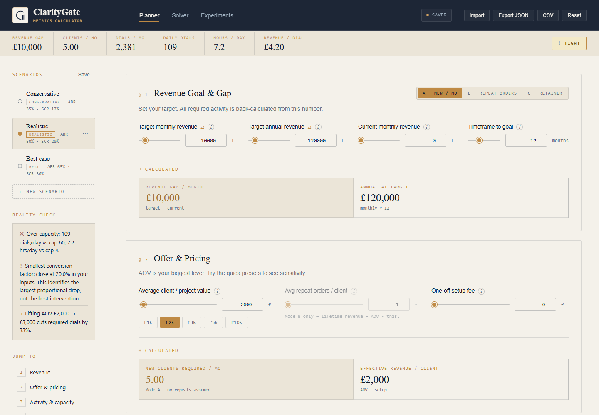
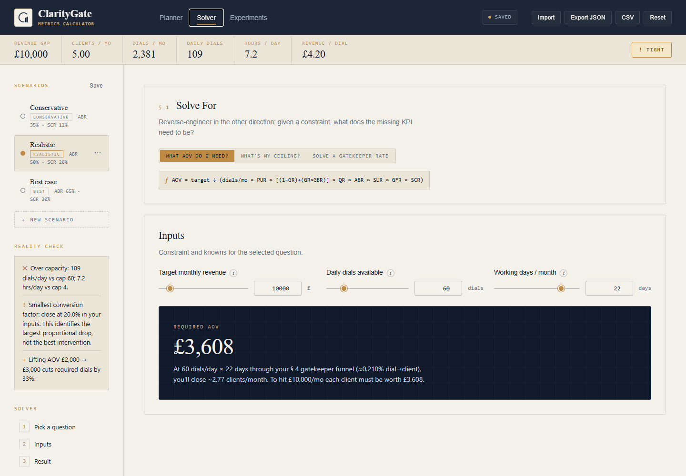
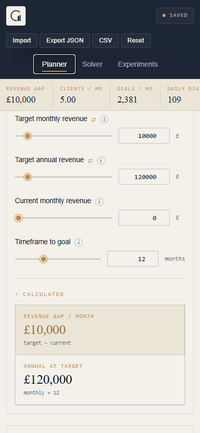

# ClarityGate KPI Calculator

A browser-based planning tool that connects a revenue goal to the sales activity needed to support it. It models a cold-call funnel, including direct stakeholder contact and a separate gatekeeper branch, so users can test how pricing, conversion rates and available time affect a plan.

[Live calculator](https://claritygate.co/kpi-calculator/) · Portfolio: [Ruben Fernandez](https://github.com/rubenfernandezz)

This repository contains a standalone portfolio edition maintained separately from the live ClarityGate deployment.

## Features

- **Planner:** new monthly revenue, repeat-order and retainer models; linked monthly/annual targets; daily, weekly and monthly activity estimates; capacity warnings.
- **Funnel exploration:** forward projections from a dial budget, reverse calculations from required clients, and a diagram showing the gatekeeper split and convergence.
- **Scenarios:** create, rename, duplicate, save and compare conversion assumptions against the same revenue goal.
- **Solver:** find the required average order value, a capacity-based revenue ceiling, or any one of the eight funnel rates while holding the others fixed.
- **Experiments:** record a hypothesis, variable, constants, sample size, baseline, target, result and keep/iterate/discard decision.
- **Persistence and exports:** browser autosave, JSON backup/restore and CSV summaries. A nine-card metric guide explains the model’s formulas and denominators.

## Screenshots

The screenshots use the bundled example assumptions.





<details>
<summary>Mobile planner</summary>



</details>

## Run locally

Use Node.js 22 or later. From the repository folder:

```sh
node tools/serve.cjs
```

Open [localhost:4173](http://127.0.0.1:4173). Starting the calculator requires no package installation, build step, account or API key. The application uses local assets and system fonts and works without an internet connection once the files are available.

For static hosting, deploy `index.html`, both `metrics-calculator` files, `metric-guide.js` and `assets/` together. All application asset paths are relative, including under a GitHub Pages project subdirectory. The live ClarityGate URL is a separate deployment.

## How it works

The stack is HTML5, CSS and vanilla JavaScript, using the DOM, FileReader, Blob downloads and localStorage. There is no application backend or runtime library dependency. Playwright is an optional development dependency for browser checks.

One state object holds inputs, scenarios, experiments and solver settings. Pure calculation functions feed the planner, diagram and comparison views. Input changes schedule rendering through `requestAnimationFrame`; autosave is debounced by 400 ms.

Eight user-entered percentages define the funnel. With rates expressed as fractions:

```text
stakeholder factor = (1 − gatekeeper rate) + gatekeeper rate × bypass rate
clients per dial = pick-up × stakeholder factor × qualification
                   × booking × show-up × pitch × close
required dials = required clients / clients per dial
daily dials = required dials × safety multiplier / working days
```

New-revenue mode divides the revenue gap by AOV plus setup fee. Repeat-order mode uses AOV × repeat orders plus setup fee. Retainer mode spreads the active-client gap across the chosen timeframe and adds replacement acquisitions for churn at the target client base. Its forward revenue preview shows new contracted MRR, excluding setup fees.

## Engineering decisions

The gatekeeper branch converges before qualification, preventing direct contacts and bypassed contacts from being counted twice. The headline plan always works backwards from the revenue goal; the forward toggle changes only the projection and diagram. This keeps exploratory dial budgets from silently changing the activity required to hit the target.

Linked targets and capacity inputs keep related values consistent. Fractional expected clients are retained in calculations; displayed activity counts round up. Unreachable positive targets display an undefined result instead of a misleading zero-activity plan.

Imports are treated as untrusted: only recognised fields are copied, numeric ranges and enums are validated, collection/file sizes are limited, and dynamic HTML values are escaped. CSV export neutralises formula prefixes in text cells. Browser data stays on the current origin; JSON and CSV exports can contain the user's planning inputs and notes.

## Contribution and skills demonstrated

ClarityGate is Ruben Fernandez’s personal project, presented here as part of his software portfolio. The implementation provides examples of translating a business planning question into an explicit mathematical model, keeping several interactive views consistent, handling linked inputs, building local persistence and portable exports, and testing numerical and security edge cases.

This edition includes defensive input handling, numerical edge-case testing and automated regression checks.

## Validation

Calculation and security regression tests use Node's built-in test runner:

```sh
npm test
```

To run browser checks, install the development dependencies and Chromium:

```sh
npm ci
npx playwright install chromium
npm run test:browser
```

The browser suite exercises planning modes, solver results, scenario editing, experiment records, persistence, imports/exports, hostile input and responsive navigation. The tests cover the included portfolio version; they are not a substitute for an independent security assessment.

## Model limits and reuse

This is a deterministic planning model. Repeat orders are averaged over the planning period; the retainer ramp uses a target-base churn approximation. It does not simulate payment timing, cohort retention, costs or profit. The solver has independent inputs and uses a one-off AOV model. Capacity feedback and experiment recommendations are heuristics; they are not statistical tests. Fixed workload warnings at 200 dials/day and 5 or 8 productive hours/day are interface rules, not validated industry limits. The sidebar identifies the smallest conversion factor in the entered funnel without prescribing industry targets.

The metric guide contains definitions derived from this implementation. Bundled rates and scenarios are illustrative planning assumptions, not industry benchmarks or measured business results. All state is stored in the browser; there is no account, server backup or cross-device sync.

No open-source licence has been granted. This repository is presented for portfolio review, with the ClarityGate branding included by its owner. Public GitHub repositories can be viewed and forked under [GitHub’s terms](https://docs.github.com/en/repositories/managing-your-repositorys-settings-and-features/customizing-your-repository/licensing-a-repository). See [third-party notices](THIRD_PARTY_NOTICES.md) for the development dependencies.
